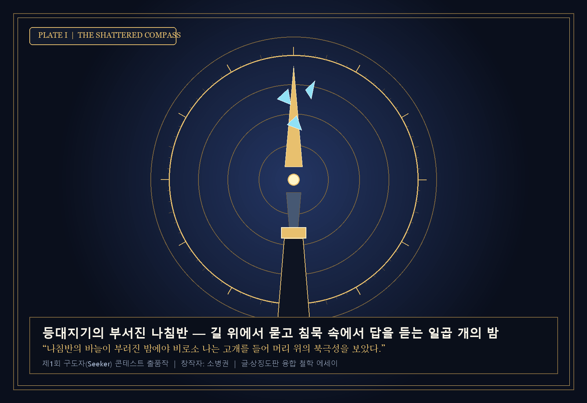
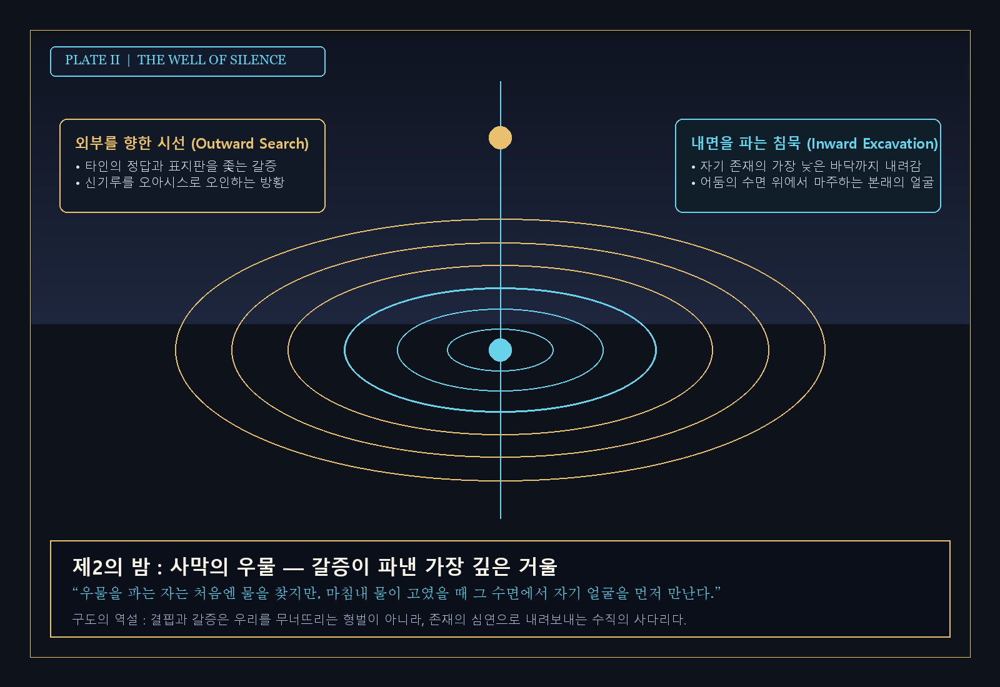
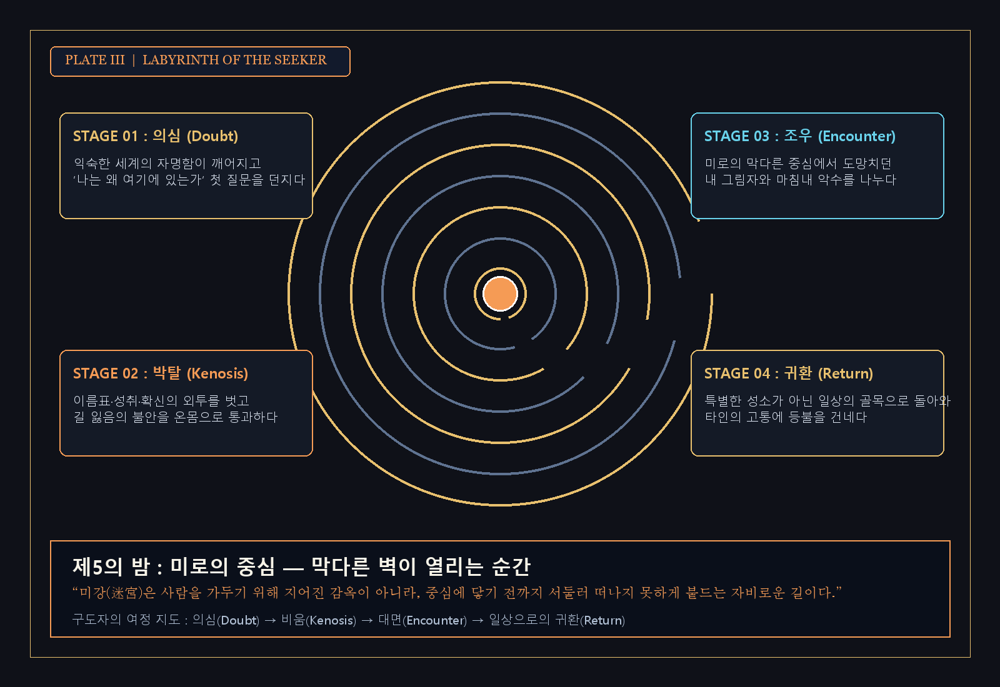
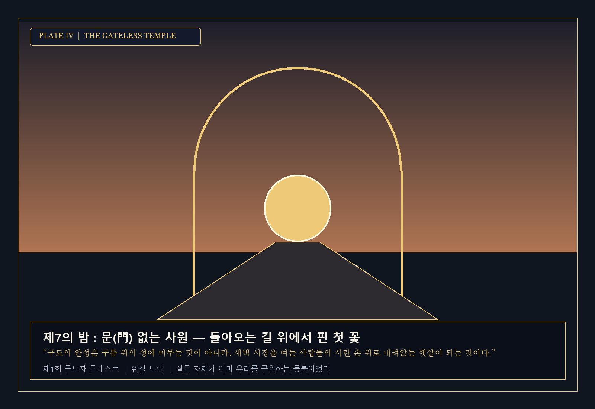

# 『등대지기의 부서진 나침반 — 길 위에서 묻고 침묵 속에서 답을 듣는 일곱 개의 밤』

> **[굿제레미] 제1회 구도자(Seeker) 콘테스트 출품작**
> - **창작자**: 소병권 (`petaflo.com@gmail.com`)
> - **작품 형식**: 일러스트 철학 에세이 북 (상징 시각 아트워크 4종 + 7개의 철학 산문 융합 창작물)
> - **PDF 아트북 원문 다운로드**: [Seeker_Contest_2026_Shattered_Compass_SoByungKwon.pdf](./Seeker_Contest_2026_Shattered_Compass_SoByungKwon.pdf)

---

## 작품 기획 의도 (500자 요약)
평생 손바닥 안의 작은 황동 나침반만 내려다보며 살아오던 등대지기가 폭풍우 속에서 나침반이 부서진 밤, 비로소 고개를 들어 밤하늘의 진짜 북극성을 마주하게 된다는 철학적 우화에서 출발한 글·그림 융합 에세이입니다. 타인이 정해준 정답의 지도를 잃어버릴 때 비로소 시작되는 구도(求道)의 여정을 일곱 개의 밤과 4점의 기하학적 상징 도판(부서진 나침반·침묵의 우물·구도자의 미로·문 없는 사원)으로 직조했습니다. 결핍과 갈증은 형벌이 아니라 자기 존재의 가장 깊은 수면과 만나게 하는 수직의 사다리이며, 진정한 구도의 완성은 세속을 떠난 골방의 도피가 아니라 다시 일상의 골목으로 돌아와 타인의 시린 발걸음 앞에 작은 등불을 내어 거는 연대임을 전합니다.

---

## 상징 도판 및 본문 아카이브 (Visual Plates & Seven Nights)

### 프롤로그 · 첫 번째 밤 : 나침반의 바늘이 부러지던 날

바다 끝 외딴 암초 위에서 삼십 년 동안 등대를 지켜온 사람이 있었다. 그의 손바닥에는 아버지에게서 물려받은 낡은 황동 나침반 하나가 늘 들려 있었다. 폭풍우가 몰아쳐 수평선이 지워지는 밤에도 그는 손안의 작은 자침(磁針)이 가리키는 북쪽을 믿으며 등탑의 회전 렌즈를 닦았다. 세상이 아무리 흔들려도 손바닥 안의 눈금만 또렷하다면 길을 잃지 않으리라 믿었던 것이다.

그러던 어느 겨울 밤, 유례없는 자기(磁氣) 폭풍이 해협을 덮쳤다. 벼락이 등탑의 피뢰침을 때리는 순간, 그가 평생토록 의지해 온 나침반의 유리가 갈라지며 자침이 두 동강 나 바닥으로 떨어졌다. 등대지기는 얼어붙은 손으로 부서진 바늘 조각을 주워 모으며 절망했다. 북쪽을 가리켜 주던 유일한 기준이 사라진 지금, 자신은 어디를 향해 불을 비추어야 하는가.

그가 울먹이며 깨진 나침반에서 마침내 눈을 떼고 등탑 밖의 밤하늘로 고개를 들었을 때, 기이한 일이 일어났다. 평생 손바닥 안의 작은 눈금만 내려다보느라 한 번도 제대로 올려다본 적 없던 밤하늘 한가운데에, 수천 년 전부터 변함없이 자리를 지키고 있던 진짜 ‘북극성’이 시리도록 푸른 빛을 쏟고 있었던 것이다. 손안의 작은 도구가 부서지고 나서야 비로소 우주 전체가 나침반이었음을 깨닫는 순간—모든 구도자(Seeker)의 여정은 바로 이 ‘부서짐’의 자리에서 시작된다.

### 두 번째 밤 : 정답의 지도를 버리고 질문의 신발을 신다

우리는 태어나는 순간부터 수많은 ‘정답의 지도’를 배급받는다. 몇 살에는 어느 관문을 통과해야 하고, 어떤 직함과 숫자를 획득해야 안전한 삶인지 적힌 매뉴얼들이 우리의 불안을 달래 준다. 그러나 어느 날 문득, 남들이 그어 놓은 실선을 따라 성실히 걸어왔음에도 가슴 한가운데에 설명할 수 없는 서늘한 공허가 불어올 때가 있다. ‘이 길의 끝에는 정말 나의 얼굴이 기다리고 있는가?’라는 첫 질문이 목구멍에 가시처럼 걸리는 순간이다.

구도자란 누구인가. 그는 세속의 책임을 도피해 산속으로 숨어드는 염세주의자가 아니다. 오히려 남들이 당연하다고 여기는 삶의 표면을 정직하게 의심하고, 빌려 입은 정답의 외투보다 비에 젖더라도 ‘나만의 질문’이라는 거친 맨발을 택하는 사람이다. 정답은 우리를 멈추게 하지만, 진실한 질문은 우리를 다시 걷게 만든다.

### 세 번째 밤 : 사막의 우물 — 갈증이 파낸 가장 깊은 거울

길을 나선 구도자가 가장 먼저 마주하는 것은 메마른 사막의 갈증이다. 아무리 걸어도 신기루만 아른거릴 뿐 대답의 오아시스는 나타나지 않는다. 이때 구도자는 밖을 향해 달리는 걸음을 멈추고, 자신이 서 있는 바로 그 발밑의 모래를 파 내려가기 시작한다. 내면의 심연을 향한 수직의 굴착(掘鑿), 곧 ‘침묵’의 시간이다.

손톱이 닳도록 자기 존재의 어두운 바닥을 파 내려간 끝에 마침내 차가운 지하수가 스며 나올 때, 우물을 판 사람은 놀라운 진실과 마주한다. 물을 마시기 위해 고개를 숙인 그 맑은 수면 위에, 다름 아닌 자신의 본래 얼굴이 별빛과 함께 비치고 있기 때문이다. 우리를 괴롭히던 실존의 갈증은 형벌이 아니라, 우리가 자기 자신의 가장 깊은 수면(水面)과 만나도록 이끌어 준 초대장이었다.

### 네 번째 밤 : 빈 배(虛舟)의 역설 — 내려놓아야 건너는 강

강가에 다다른 구도자는 나룻배에 오르기 전 자신이 짊어지고 온 배낭을 풀어 본다. 그 안에는 그동안 세상에서 인정받기 위해 모아 온 증명서들, 타인에게 상처받지 않기 위해 둘러친 자존심의 갑옷, 심지어 ‘나는 진리를 찾는 특별한 사람’이라는 구도적 오만함까지 무거운 돌멩이처럼 들어차 있다.

물은 속이 텅 빈 배는 가볍게 띄워 주지만, 무거운 보물로 가득 찬 배는 가차 없이 강바닥으로 가라앉힌다. 구도의 중턱에서 가장 어려운 일은 새로운 지식을 더 채우는 일이 아니라, 내가 움켜쥐고 있던 ‘나라는 집착’을 하나씩 강물에 놓아주는 일이다. 손바닥을 펴야 비로소 바람이 지나가고, 배 안을 비워야 비로소 강 건너편의 기슭이 다가온다.

### 다섯 번째 밤 : 미로의 중심에서 만난 나의 그림자

안개 자욱한 미로(Labyrinth)의 중심부에 들어섰을 때, 구도자는 마침내 한 형상과 마주 선다. 찬란한 후광을 두른 현자(賢者)가 있으리라 기대했던 그 자리에 서 있는 것은, 평생 자신이 외면하고 감추려 했던 자신의 초라한 약점과 두려움, 곧 ‘그림자’였다.

그러나 구도자는 더 이상 도망치지 않고 그 그림자의 시린 손을 잡아 안아 준다. 빛이 강할수록 그림자도 짙어지는 법, 내 안의 어둠과 결핍을 미워하지 않고 삶의 일부로 껴안는 순간 미로의 높다란 벽들은 거짓말처럼 낮아진다. 완전무결해지는 것이 구원이 아니라, 불완전한 자신을 온전히 긍정하고 사랑하게 되는 것이야말로 미로의 중심이 숨겨 둔 비밀이었다.

### 여섯 번째 밤 : 등대는 스스로를 비추지 않는다

다시 해안의 등탑으로 돌아온 등대지기는 깨달았다. 등대의 거대한 프리즘 렌즈는 정작 등대 자신의 발밑을 자랑하기 위해 존재하는 것이 아니라, 칠흑 같은 밤바다에서 방향을 잃고 흔들리는 작은 고깃배 한 척을 위해 어둠 속으로 빛의 다리를 놓아주는 존재라는 사실을.

진정한 구도는 나 혼자만의 평안에 안주하는 골방의 깨달음으로 끝나지 않는다. 내가 어둠 속에서 겪었던 그 막막함과 눈물을 기억하기에, 지금 길 위에서 떨고 있는 또 다른 구도자의 발걸음 앞에 말없이 작은 등불 하나를 내어 걸어 주는 연대(連帶)—그것이 구도자가 세상에 남기는 가장 아름다운 기도다.

### 에필로그 · 일곱 번째 아침 : 문(門) 없는 사원, 일상의 골목으로

일곱 번의 밤이 지나고 수평선 너머로 첫 새벽빛이 번져 온다. 구도자는 이제 부서진 나침반을 버리지 않고 주머니 속에 소중히 간직한 채 등대 아래 마을의 시장통으로 걸어 내려간다. 생선 상자를 내리는 어부의 거친 숨소리, 떡집 굴뚝에서 피어오르는 하얀 김, 골목 담장 밑에 피어난 작은 냉이꽃 한 송이가 그 어느 경전의 문자보다도 눈부신 경이로 다가온다.

진리는 구름 너머 먼 곳에 숨겨진 보물이 아니었다. ‘어떻게 살아야 하는가’를 묻고 또 물으며 걸어온 그 성실한 발걸음 자체가 이미 길(道)이었고, 세상을 향해 마음을 열어 둔 우리의 일상 전체가 ‘문 없는 사원’이었다. 오늘도 각자의 자리에서 조용히 질문을 멈추지 않는 세상의 모든 구도자들에게, 새벽 바다의 첫 등불을 바친다.
